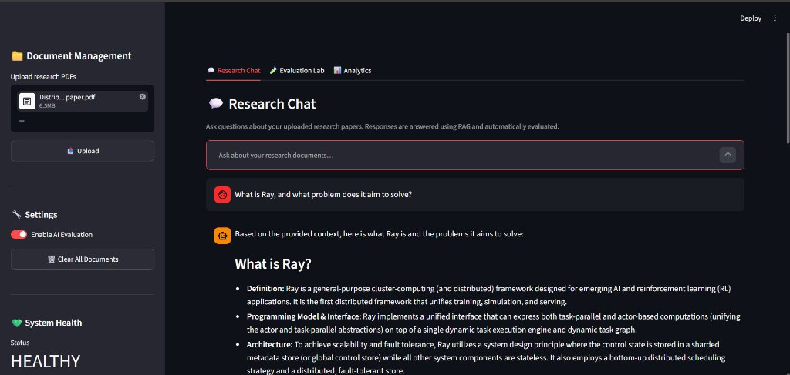
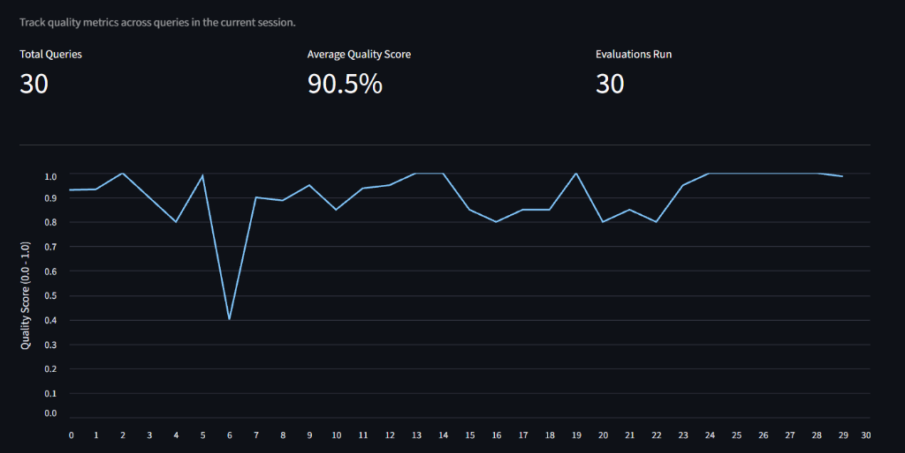
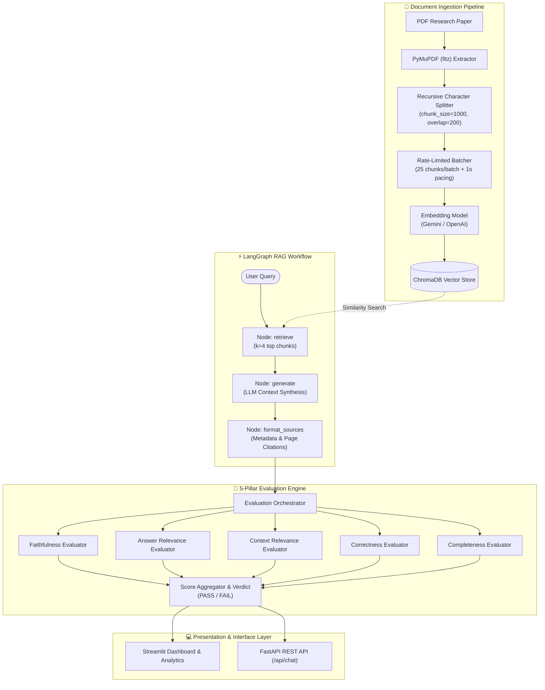

# 🔬 AI Research Analyzer & Evaluation Engine

[](https://fastapi.tiangolo.com)
[](https://streamlit.io)
[](https://langchain.com)
[](https://langchain-ai.github.io/langgraph/)
[](https://www.trychroma.com)
[](https://www.python.org)
[](tests/)

An end-to-end, production-grade **Retrieval-Augmented Generation (RAG)** research assistant and **Automated AI Evaluation Engine**. The system ingests academic papers and complex documentation, performs stateful semantic retrieval via **LangGraph**, and evaluates generated responses against **5 core quality dimensions** (Faithfulness, Answer Relevance, Context Relevance, Semantic Correctness, and Completeness) to detect and mitigate hallucinations in real time.

---

## 📌 Table of Contents
- [Executive Overview](#-executive-overview)
- [The Problem: Silent Failures in RAG](#-the-problem-silent-failures-in-rag)
- [The 5-Pillar Evaluation Framework](#-the-5-pillar-evaluation-framework)
- [Empirical Quality Benchmarks](#-empirical-quality-benchmarks)
- [System Architecture](#-system-architecture)
- [Core Features & Engineering Highlights](#-core-features--engineering-highlights)
- [Project Directory Structure](#-project-directory-structure)
- [API Endpoints](#-api-endpoints)
- [Quick Start & Setup](#-quick-start--setup)
- [Test Suite](#-test-suite)

---

## 🌟 Executive Overview

Retrieval-Augmented Generation (RAG) is standard for querying private or specialized corpora. However, unmonitored RAG pipelines frequently hallucinate, retrieve noisy context, or omit critical nuances.

The **AI Evaluation Engine** provides a closed-loop RAG pipeline where:
1. **Documents are parsed and indexed** with PyMuPDF and ChromaDB.
2. **Queries are executed** across a deterministic LangGraph `StateGraph`.
3. **Responses are audited in real-time** by an LLM-as-a-Judge evaluation orchestrator that computes granular confidence scores and returns an overall pass/fail quality verdict.



---

## ⚠️ The Problem: Silent Failures in RAG

Standard RAG architectures suffer from three critical failure modes:

```
┌────────────────────────────────────────────────────────────────────────┐
│                        RAG Failure Modes                               │
├─────────────────────────┬─────────────────────────┬────────────────────┤
│   Context Noise / Bias   │     Hallucinations      │   Incompleteness   │
│ (Retriever pulls chunks │  (LLM generates facts   │ (LLM omits crucial │
│   unrelated to query)   │ not in retrieved docs)  │  data or caveats)  │
└─────────────────────────┴─────────────────────────┴────────────────────┘
```

Without an automated evaluation layer, these errors pass directly to end users. The **AI Evaluation Engine** resolves this by scoring every inference step independently.

---

## 🧪 The 5-Pillar Evaluation Framework

Every generated response is scored across 5 dimensions on a normalized scale of `0.0` to `1.0`:

| Dimension | Evaluator Class | Ground Truth Required? | Methodology |
|---|---|:---:|---|
| **1. Faithfulness** | `FaithfulnessEvaluator` | ❌ No | Decomposes response into atomic claims; validates each against retrieved context chunks to detect hallucinations. |
| **2. Answer Relevance** | `AnswerRelevanceEvaluator` | ❌ No | Measures semantic alignment between the question and the answer; penalizes evasive or tangent responses. |
| **3. Context Relevance** | `ContextRelevanceEvaluator` | ❌ No | Evaluates retrieval precision chunk-by-chunk to ensure the vector index provides signal rather than noise. |
| **4. Correctness** | `CorrectnessEvaluator` | ✅ Yes (Optional) | Measures semantic and factual agreement against an authoritative reference ground-truth answer. |
| **5. Completeness** | `CompletenessEvaluator` | ❌ No | Analyzes retrieved source information and penalizes the answer if key points or findings are omitted. |

### Evaluation Formula & Scoring Rubric:
$$\text{Overall Quality Score} = \frac{1}{N} \sum_{i=1}^{N} \text{Score}_i$$

- **PASS**: $\text{Overall Quality Score} \ge 0.70$
- **FAIL**: $\text{Overall Quality Score} < 0.70$

---

## 📊 Empirical Quality Benchmarks

In live test sessions querying dense multi-page academic papers (e.g., distributed systems and AGI research papers), the system achieved consistent, high-fidelity results:



### Benchmark Summary:
- **Total Queries Evaluated**: `30`
- **Evaluations Run**: `30` (100% evaluation capture rate)
- **Average Quality Score**: **`90.5%`** (`0.905 / 1.0`)
- **Performance Profile**: Over 90% of queries maintained quality scores between `0.85` and `1.0`. Transient drops (such as query #6 at 0.40) immediately flagged retrieved context noise, validating the sensitivity of the evaluation engine.

---

## 🏗️ System Architecture

The project is built with clean separation of concerns, decoupling document ingestion, vector retrieval, graph execution, and multi-metric evaluation:



---

## ⚙️ Core Features & Engineering Highlights

### 1. LangGraph StateGraph Workflow
Unlike brittle sequential chains, the RAG pipeline is modeled as a state machine using **LangGraph**:
- Tracks conversation state (`question`, `context`, `answer`, `source_documents`).
- Deterministic nodes for retrieval, context injection, and source citation formatting.

### 2. Quota & Rate-Limit Resilience
When using Google Gemini's Free Tier (which limits embedding requests to 100/min), dense research papers often crash basic RAG applications with `429 RESOURCE_EXHAUSTED` errors.
- **Micro-Batching**: Ingestion is batched in slices of 25 chunks.
- **Inter-batch Throttling**: 1-second polite delay between requests.
- **Exponential Backoff**: Automatic regex-driven retry logic that parses server retry intervals (`retryDelay: 15s`) and waits before resuming.

### 3. Provider Agnostic (Google Gemini + OpenAI)
Switch between providers simply by editing `.env`:
- **Google GenAI**: `gemini-3.5-flash-lite` + `gemini-embedding-001`
- **OpenAI**: `gpt-4o-mini` / `gpt-4o` + `text-embedding-3-small`

### 4. Interactive Web Interface & Analytics
- **Research Chat**: Live document Q&A with source page citations.
- **Evaluation Lab**: Test arbitrary (Question, Context, Answer, Ground Truth) payloads on demand.
- **Analytics Dashboard**: Real-time trend visualization of quality scores across queries.

---

## 📁 Project Directory Structure

```
AI Evaluation Engine/
├── app/
│   ├── api/
│   │   ├── __init__.py
│   │   └── routes.py              # FastAPI endpoints (/chat, /upload, /evaluate, /health)
│   ├── evaluation/
│   │   ├── __init__.py
│   │   ├── base.py                # Abstract BaseEvaluator class
│   │   ├── faithfulness.py        # Claim extraction & context verification
│   │   ├── answer_relevance.py    # Question-answer alignment
│   │   ├── context_relevance.py   # Per-chunk retrieval precision
│   │   ├── correctness.py         # Semantic ground-truth comparison
│   │   ├── completeness.py        # Information coverage analyzer
│   │   └── engine.py              # Evaluation orchestrator & verdict generator
│   ├── models/
│   │   ├── __init__.py
│   │   └── schemas.py             # Pydantic v2 data models with type coercion
│   ├── services/
│   │   ├── __init__.py
│   │   ├── document_processor.py  # PyMuPDF parser & recursive chunking
│   │   ├── vector_store.py        # ChromaDB indexer with rate-limit retries
│   │   └── rag_chain.py           # LangGraph StateGraph pipeline
│   ├── __init__.py
│   └── config.py                  # Pydantic BaseSettings & environment configs
├── assets/
│   ├── chat_interface.png         # Screenshot of Research Chat UI
│   └── evaluation_metrics.png     # Benchmark evaluation analytics chart
├── data/
│   ├── sample_dataset.json        # Reference evaluation test dataset
│   └── uploads/                   # Stored PDF research papers
├── tests/
│   ├── test_config.py             # Configuration & model alias tests
│   ├── test_schemas.py            # Pydantic schemas & coercion tests
│   ├── test_evaluators.py         # 5 evaluation metrics & engine tests
│   └── test_api.py                # FastAPI routes & integration tests
├── .env.example                   # Sample environment configuration template
├── main.py                        # FastAPI entry point
├── streamlit_app.py               # Streamlit frontend dashboard
├── setup.md                       # Comprehensive setup & installation guide
├── requirements.txt               # Project dependencies
└── README.md                      # Project documentation
```

---

## 🔌 API Endpoints

The FastAPI backend exposes the following REST endpoints:

| Method | Endpoint | Description |
|---|---|---|
| `GET` | `/api/health` | Health check & vector store document count |
| `POST` | `/api/upload` | Upload & index a PDF research document |
| `POST` | `/api/chat` | Query RAG chain with optional live evaluation |
| `POST` | `/api/evaluate` | Standalone evaluation of any Q-A-Context payload |
| `GET` | `/api/documents` | List indexed documents |
| `DELETE` | `/api/documents` | Clear vector store and document storage |

### Example: Standalone Evaluation Request
```bash
curl -X POST "http://localhost:8000/api/evaluate" \
  -H "Content-Type: application/json" \
  -d '{
    "question": "What is Ray and what problem does it solve?",
    "answer": "Ray is a distributed execution framework for AI and reinforcement learning.",
    "context": ["Ray is a general-purpose cluster-computing framework designed for emerging AI and RL applications."],
    "ground_truth": "Ray provides a unified runtime for distributed AI workloads."
  }'
```

---

## 🚀 Quick Start & Setup

For full installation and troubleshooting instructions, please refer to **[setup.md](setup.md)**.

### Summary:
```bash
# 1. Clone & activate virtual environment
git clone https://github.com/your-username/ai-evaluation-engine.git
cd "ai-evaluation-engine"
python -m venv venv
.\venv\Scripts\Activate.ps1   # Windows PowerShell (or source venv/bin/activate on Linux)

# 2. Install dependencies
pip install -r requirements.txt

# 3. Configure .env with your Google Gemini or OpenAI API key
cp .env.example .env

# 4. Start the FastAPI backend
python main.py

# 5. In a second terminal, start the Streamlit UI
streamlit run streamlit_app.py
```

---

## 🧪 Test Suite

Run the full automated test suite (all 16 tests pass out of the box):
```bash
pytest -v tests/
```

---

## 📜 License
This project is licensed under the **MIT License**.
